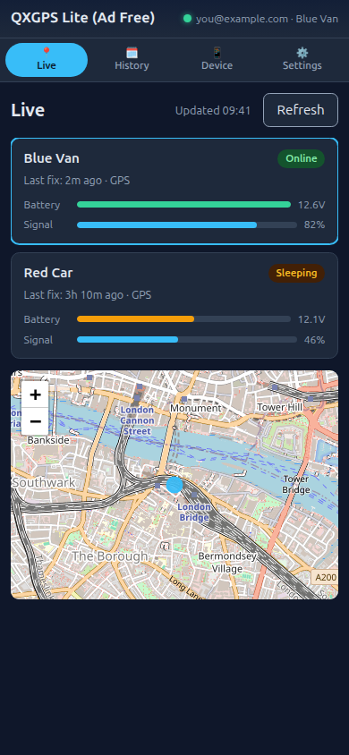
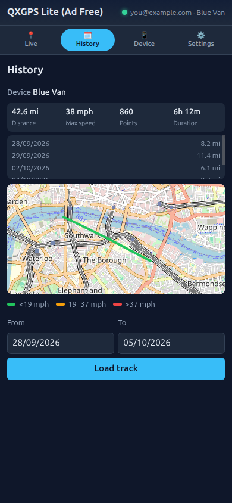
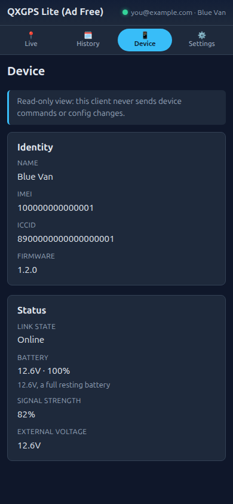
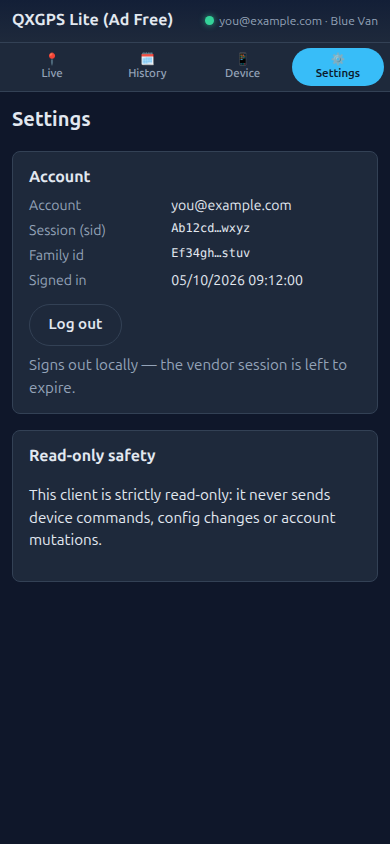
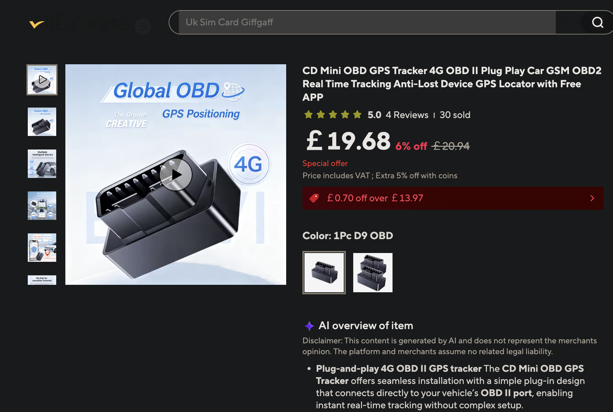

# qxgps-pwa

An ad-free client for viewing GPS trackers on the QXGPS / QXHL vendor cloud — a
read-only alternative to the stock mobile app (`com.flu.qxhlgg`).

## Two release targets

| Target | What you get | Best for |
| --- | --- | --- |
| **PWA** | Static `dist/` (any HTTPS host; [GitHub Pages](https://pages.github.com/) on each version tag) | Phones, tablets, and desktops with a modern browser — install from the browser, offline app shell, in-tab alarm alerts while open |
| **Android APK** | Tauri v2 build (F-Droid-ready) | **Native background monitoring** — foreground-service polling, local notifications for alarms/link-state changes, no Firebase / Play Services |

Tagged releases (`v*`) publish **both**: a zipped PWA (`qxgps-pwa-<tag>-dist.zip`) and an
unsigned release APK. See [.github/workflows/release.yml](.github/workflows/release.yml).

Use the **PWA** when a browser is enough. Use the **APK** when you want background
checks similar to the vendor app’s native behaviour (still read-only toward the API).

Screenshots use **fictional vehicles** and **sample London-area map coordinates**
(`you@example.com`). They are not a real account.

| Live | History |
| --- | --- |
|  |  |

| Device | Settings |
| --- | --- |
|  |  |

## Example hardware



Example of the 4G OBD-II plug-in tracker class this client interoperates with (marketplace listing screenshot for identification only; not affiliated or endorsed).

## Disclaimer

This project is **unofficial** and **not affiliated with, endorsed by, or sponsored
by** the device manufacturer or platform operator. “QXGPS” and related names are
trademarks of their respective owners.

Software is provided **as is**, without warranty. It exists for **interoperability**
with hardware and accounts **you own or are authorised to use**. Reverse-engineering
notes in this repo describe protocol behaviour for interoperability research only —
**no vendor firmware, proprietary binaries, copied vendor code, or authentication
keys** are included.

You must comply with applicable **privacy and location-tracking laws** (including
obtaining consent before tracking people). See [PRIVACY.md](PRIVACY.md).

## Features

- Live map with device list and status polling
- History track with speed-coloured polyline and playback
- Per-day mileage calendar (`QueryTrackDate`) with quick date selection
- Device detail and read-only configuration display
- Alarm list and optional browser notifications for new alarms
- Installable PWA with offline app shell and cached map tiles
- Android APK with optional background device checks and local notifications (Tauri)
- **Strictly read-only** toward the vendor API (login + `Get*` / `Query*` only)

## Quick start

Requires **Node 18+** (22 recommended).

```bash
npm install
npm run dev          # http://127.0.0.1:5173 (Vite default)
```

Sign in with the same email/password as the vendor app (QXHL / type 58 white-label).

```bash
npm run typecheck
npm test
npm run lint
npm run build
npm run preview      # static preview of dist/
```

### Self-hosted production

**Option A — static hosting (recommended):** deploy `dist/` to any HTTPS host. The
browser calls `https://www.gps666.net/mapi` directly (the vendor endpoint allows CORS).

**Option B — bundled relay:** serve the build and proxy vendor HTTP from the same
origin (useful if you serve over HTTP or need Dart-style request fingerprints):

```bash
npm run build
npm run relay        # http://127.0.0.1:8787 — serves dist/ + /mapi, /rvsgeo
```

Relay environment variables:

| Variable | Default | Purpose |
| --- | --- | --- |
| `PORT` | `8787` | Listen port |
| `HOST` | `127.0.0.1` | Bind address |
| `STATIC_DIR` | `<repo>/dist` | Built PWA files |
| `MAPI_UPSTREAM` | `http://app.gps666.net` | Vendor mapi |
| `RVSGEO_UPSTREAM` | `http://rvsgeo.gps666.net` | Reverse geocoding |

## How it works

```
┌─────────────────┐   HTTPS fetch (CORS)     ┌──────────────────────┐
│ PWA (Preact +   │ ───────────────────────► │ www.gps666.net/mapi  │
│ Vite + Leaflet) │ ◄─────────────────────── │ (vendor cloud)         │
└─────────────────┘                          └──────────────────────┘

Optional self-host:
┌─────────────────┐   same-origin /mapi      ┌──────────────────────┐   HTTP    ┌─────────────┐
│ PWA             │ ───────────────────────► │ server/relay.mjs     │ ────────► │ app.gps666… │
└─────────────────┘                          └──────────────────────┘           └─────────────┘
```

Login sends `user.Login` with MD5 password hash (`pwd_md5`) and merchant `type: 58`.
Session `sid` is appended as `?sid=` on subsequent calls. Protocol details:
[docs/protocol-notes.md](docs/protocol-notes.md).

The service worker precaches the app shell and caches OpenStreetMap tiles. **`/mapi`
is never cached** — positions are always fetched live.

## Browser support

Modern Chromium, Firefox, and Safari with service worker and `fetch` support.
Install prompts appear when the PWA criteria are met (HTTPS, manifest, icons).

## Android (F-Droid oriented)

**Tauri v2** wraps the same UI for sideloading or F-Droid (system WebView via WRY
plus a small Rust runtime). FOSS toolchain — no Play Services, Firebase, ads, or
analytics SDKs.

- **Application id:** `io.github.jr551.qxgps` — set in
  `src-tauri/tauri.conf.json` (`identifier`).
- **Versioning:** `bundle.android.versionCode` in `tauri.conf.json` (0.2.0 → **200**).
- **Build:** [docs/android-tauri.md](docs/android-tauri.md) — `npm run build:android`
  (unsigned release APK) and `npm run build:android:debug`.
- **CI:** [.github/workflows/tauri.yml](.github/workflows/tauri.yml) validates APK
  builds on pull requests; [.github/workflows/release.yml](.github/workflows/release.yml)
  publishes the PWA (Pages + zip) and APK on version tags.
- **Store metadata:** `fastlane/metadata/android/en-US/`
- **Draft F-Droid recipe:** [docs/fdroid/io.github.jr551.qxgps.yml](docs/fdroid/io.github.jr551.qxgps.yml)

**F-Droid anti-features to declare:** `NonFreeNet` (users connect to the
proprietary vendor tracker cloud with their own account). The app itself contains
no trackers or non-free libraries.

**Native background monitoring** (Tauri only): optional read-only polling and local
notifications — see [PRIVACY.md](PRIVACY.md) and [docs/android-tauri.md](docs/android-tauri.md).
No Firebase / Play Services.


## Licence

[MIT](LICENSE) — see [THIRD_PARTY_NOTICES](THIRD_PARTY_NOTICES) for dependencies.

## Contributing

See [CONTRIBUTING.md](CONTRIBUTING.md) and [SECURITY.md](SECURITY.md).
